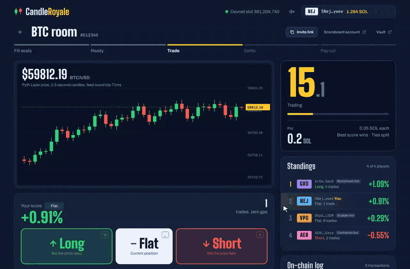
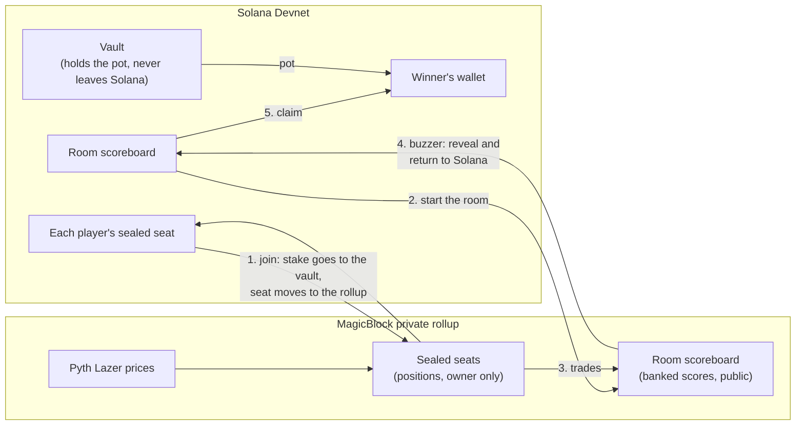

# CandleRoyale

**A 60-second trading showdown on Solana. Everyone stakes SOL, trades one live price, and the best score takes the pot. Nobody can see your position until the buzzer.**

<p align="center">
  
  <br>
  <sub>The end of a round against three practice bots: sealed positions, the buzzer reveal, the payout. Recorded from the real interface with scripted prices.</sub>
</p>

Try it on Devnet: **[candleroyale.vercel.app](https://candleroyale.vercel.app)**

Built for **MagicBlock Solana Blitz v10, Entertainment Finance**.

---

## What it is

Two to six players each put the same amount of SOL into a pot. For 60 seconds, everyone trades one live price (SOL, BTC or ETH) at 20× leverage. You can go long, short or flat as often as you like. When the clock hits zero, whoever is furthest ahead takes the whole pot.

You approve once with your wallet to join. After that, every trade is instant, free, and needs no wallet popups.

## How a round works

1. **Stake.** Everyone's SOL goes into a vault on Solana. It stays there the whole round.
2. **Trade.** Flip long, short or flat on the live price. Each trade is measured from the price you entered at, and when you switch, the result of your old trade is locked into your score.
3. **The buzzer.** At zero, every open trade closes at the live price and every position is revealed.
4. **Payout.** The best score takes the pot straight to their wallet. Ties split it equally.

No one to play with? Add practice bots. Each one is a real player with its own wallet and its own stake in the pot, and they hand their SOL back to you after the round.

## Why positions are sealed

If everyone can see everyone's position, the game breaks near the end. Say you're ahead with 15 seconds left. You can just copy whatever the person chasing you does: they go long, you go long; they flip short, you flip short. Whatever the price does, you both move together, so your lead is frozen and you win without reading the market at all.

So in CandleRoyale, **your position is sealed until the buzzer**:

- **Hidden while the clock runs:** which way each player is pointed, the price they got in at, and how much their open trade is up or down.
- **Public the whole time:** who's playing, the pot, each player's banked score (from trades they've already closed) and how many trades they've made. That's what spectators and invite link previews show. Rooms appear on the room list unless the creator picks **Invite link only**, which keeps a room unlisted (still on Solana, so not secret).
- **Revealed at the buzzer:** what everyone was holding, right before the winner is announced.

Nobody can freeze the game by copying. You have to out-trade the market right up to the end.

One honest limit: when someone closes a trade, their banked score jumps, and the size of that jump hints at which way they were pointed. Their *current* trade still stays hidden.

## How MagicBlock makes it work

- **Free, instant trades with no popups.** The room moves onto MagicBlock's rollup for the round, a fast lane next to Solana where trades cost nothing. Your browser holds a temporary key for that room, so you don't approve every tap.
- **Sealed positions.** It's MagicBlock's private rollup, which runs inside a secure enclave. Your first trade locks your seat so only you can read it, and the rollup hides your trades from everyone else.
- **Live prices inside the rollup.** Pyth prices update right where the trades happen, so every trade uses a fresh price.
- **Your money never leaves Solana.** Only the scoreboard and the sealed seats go to the rollup. At the buzzer they come back to Solana together, and the vault pays the winner there, where anyone can check it.

## Keeping the money safe

- **No timing the close.** Settlement only uses a live price taken within 3 seconds of the buzzer. After that, positions close at the last traded price, so nobody can wait for a better moment.
- **Fresh prices only.** Any price older than 10 seconds is rejected.
- **Only the room creator can start a round**, and only on MagicBlock's private rollup. A room can't start until every player's seat has been sealed in.
- **Nothing gets stuck.** If a room is never started, or nobody trades after it starts, any player can cancel it and everyone gets their stake back.
- **Fair payouts.** Tied winners split the pot equally, and each seat can only claim once.
- **No spam.** Each player's temporary key is unique, and "trades" that don't change your position are rejected.

---

## For developers

<details>
<summary><strong>Addresses</strong></summary>

| What | Address |
|---|---|
| Program (Devnet) | `72pppjfTWKZ9GQARXtt2dkB4t8VNDaL5gA84MajAUXFS` |
| MagicBlock private rollup | `https://devnet-tee.magicblock.app` (needs a sign-in token) |
| Private rollup validator | `MTEWGuqxUpYZGFJQcp8tLN7x5v9BSeoFHYWQQ3n3xzo` |
| MagicBlock delegation program | `DELeGGvXpWV2fqJUhqcF5ZSYMS4JTLjteaAMARRSaeSh` |
| MagicBlock permission program | `ACLseoPoyC3cBqoUtkbjZ4aDrkurZW86v19pXz2XQnp1` |
| Pyth Lazer oracle program | `PriCems5tHihc6UDXDjzjeawomAwBduWMGAi8ZUjppd` |
| SOL/USD feed | `ENYwebBThHzmzwPLAQvCucUTsjyfBSZdD9ViXksS4jPu` |
| BTC/USD feed | `71wtTRDY8Gxgw56bXFt2oc6qeAbTxzStdNiC425Z51sr` |
| ETH/USD feed | `5vaYr1hpv8yrSpu8w3K95x22byYxUJCCNCSYJtqVWPvG` |

</details>

<details>
<summary><strong>How the pieces fit</strong></summary>



</details>

<details>
<summary><strong>Program instructions</strong></summary>

| Instruction | Where | Who signs | What it does |
|---|---|---|---|
| `create_room` | Solana | Creator | Makes the vault, the scoreboard and the creator's seat, and stakes the creator's SOL |
| `join_room` | Solana | Player | Stakes into the vault and makes the player's seat (must be the next free one) |
| `delegate_seat` | Solana | Player | Moves the player's seat to the private rollup (sent together with create or join) |
| `cancel_room` | Solana | Creator | Refunds a creator whose room nobody joined |
| `abort_stale_lobby` | Solana | Any seated player | Unlocks refunds for a room that was never started (after 15 minutes) |
| `start_and_delegate` | Solana | Creator | Checks every seat is on the private rollup, then moves the scoreboard there |
| `begin_round` | Rollup | Player or temp key | Locks the opening price and starts the clock |
| `tap` | Rollup | Player or temp key | Changes position. Writes it only to the player's sealed seat, banks the old trade on the public scoreboard, and seals the seat on the first trade |
| `finish_round` | Rollup | Anyone | Reads every sealed seat, closes and reveals each position, picks the winner, and sends the scoreboard and seats back to Solana |
| `abort_stale_room` | Rollup | Anyone | Sends an idle started room back to Solana for refunds (after 3 minutes) |
| `claim_payout` | Solana | Anyone | Pays a winner, splits a tie, or refunds a cancelled room, one seat at a time |

</details>

<details>
<summary><strong>Run it yourself</strong></summary>

```bash
# Program: test, build, deploy (upgrades the same program ID)
cargo test
anchor build
anchor deploy --provider.cluster devnet

# Checks against Devnet
npm install
npm run test:codec
npm run e2e:devnet

# Web app
cd app
npm install
npm run dev
```

Open `http://localhost:3000` with a wallet on Devnet. Use a second browser or the built-in Devnet burner wallet to play yourself, or add practice bots.

</details>

<details>
<summary><strong>Earlier Devnet proof (before sealed positions)</strong></summary>

A full two-player round, plus six attempts to break the rules that the program rejected, run end to end on Devnet against MagicBlock's public rollup before the private version:

- Create room: [`2365ZbSz…`](https://explorer.solana.com/tx/2365ZbSzhme4zr6io5JKGq7RoHBGMrWepAb4has4rR4fa55Q511Sma9zbd1Sy2mK262BcDHP2XNFGmUCSNY71FoX?cluster=devnet)
- Join: [`3pNPDqBt…`](https://explorer.solana.com/tx/3pNPDqBtyJ3vUeBHue8wasE5Q5ymrYeWh1JbZyQb9VspcTowRVHRNee4JN9TY7LQSHRab3iHgHkj4kBoz3KoSsc8?cluster=devnet)
- Start on the rollup: [`4QME4gbx…`](https://explorer.solana.com/tx/4QME4gbx2iZ9rVVxScyaNTMt1Pg2Xp23vKGHD5YsRsRFFHFhSdwzAJfLT3RQRAj7Hq3ueB3SgUjGxrSJZSqeUYJ5?cluster=devnet)
- Five trades and the settlement on the rollup, no gas
- Payout to the winner: [`467UsYf8…`](https://explorer.solana.com/tx/467UsYf87YduwJcr5ZNY3pPxZE44u3HirnrmoWrc1mvJCikQyGM8166YhS6dYRRVRSh77YakxB84aaRAQviH4b79?cluster=devnet)
- Rejected as expected: a reused temporary key, starting on a rollup other than the pinned one, a non-creator starting the room, an early abort, a trade that changed nothing, and a double claim

</details>
