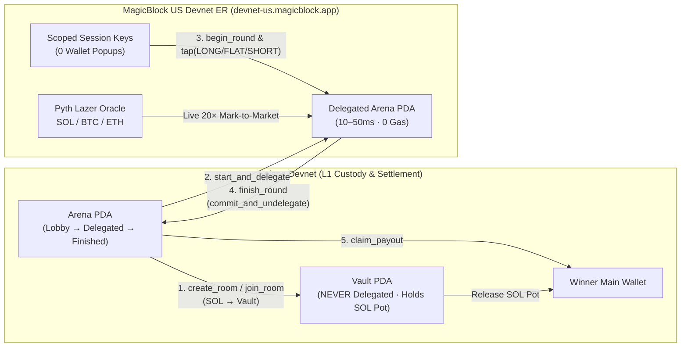

# CandleRoyale

**60-second PvP micro-trading battle royale on Solana & MagicBlock Ephemeral Rollups.**

2–6 players escrow real SOL into a Solana L1 vault, delegate the battleground into a **MagicBlock Ephemeral Rollup**, and race for 60 seconds flipping **20× LONG / FLAT / SHORT** against live **Pyth Lazer** feeds with **zero gas** and **zero wallet popups** via scoped in-browser Session Keys. When the clock hits zero, MagicBlock commits and undelegates the verified winner back to Solana L1 to unlock the entire pot.

Built for **MagicBlock Solana Blitz v10 — Theme: Entertainment Finance**.

---

## Why MagicBlock Is Load-Bearing

A 60-second tap-trading battle is impossible on base Solana L1:

| Requirement | Base Solana L1 | CandleRoyale on MagicBlock |
|---|---|---|
| Rapid position flips (`LONG / FLAT / SHORT`) | ~400ms slots + fee every tap | **Sub-50ms ER execution, 0 gas** |
| Wallet UX during 60s sprint | Phantom popup every click | **Scoped Session Key** bound once at `join_room` |
| Price feed freshness | ~400ms base updates | **Live Pyth Lazer on ER** (~50–200ms ticks) |
| Funds security | Single-layer | **L1 Vault PDA never delegated**; only `Arena` PDA enters ER |

Remove MagicBlock Ephemeral Rollups, Session Keys, or the ER Pyth Lazer feed and the product breaks.

---

## Architecture



---

## On-Chain Endpoints & Program

| Resource | Value |
|---|---|
| **Program ID (Devnet)** | `3fgXDqKzQiQQUSfbPXnyuonqJi8BMbeGf9vnxxH9bEtN` |
| **MagicBlock ER RPC** | `https://devnet-us.magicblock.app` |
| **ER Validator (US Devnet)** | `MUS3hc9TCw4cGC12vHNoYcCGzJG1txjgQLZWVoeNHNd` |
| **Delegation Program** | `DELeGGvXpWV2fqJUhqcF5ZSYMS4JTLjteaAMARRSaeSh` |
| **Pyth Lazer Oracle Program** | `PriCems5tHihc6UDXDjzjeawomAwBduWMGAi8ZUjppd` |
| **SOL/USD ER Feed** | `ENYwebBThHzmzwPLAQvCucUTsjyfBSZdD9ViXksS4jPu` |
| **BTC/USD ER Feed** | `71wtTRDY8Gxgw56bXFt2oc6qeAbTxzStdNiC425Z51sr` |
| **ETH/USD ER Feed** | `5vaYr1hpv8yrSpu8w3K95x22byYxUJCCNCSYJtqVWPvG` |

---

## Program Instructions

| Instruction | Layer | Signer | Purpose |
|---|---|---|---|
| `create_room` | Solana L1 | Creator Wallet | Initializes `Vault` + `Arena` PDAs, escrows creator's SOL, binds Seat 0 `session_key` |
| `join_room` | Solana L1 | Joiner Wallet | Escrows entry SOL into `Vault` PDA, binds joiner's `session_key` |
| `cancel_room` | Solana L1 | Creator Wallet | Refunds solo creator if nobody else joined |
| `start_and_delegate` | Solana L1 | Seated Player | Delegates `Arena` PDA to pinned MagicBlock ER validator |
| `begin_round` | MagicBlock ER | Session Key | Locks live Pyth Lazer opening price & starts countdown (0 gas) |
| `tap` | MagicBlock ER | Session Key | Marks previous position to market at 20× leverage & flips `LONG / FLAT / SHORT` (0 gas, 0 popups) |
| `finish_round` | MagicBlock ER | Session Key / Player | Marks all seats to market at expiry, crowns winner, and calls `MagicIntentBundleBuilder::commit_and_undelegate` |
| `claim_payout` | Solana L1 | Permissionless | Verifies `Arena` returned to L1 as `Finished` and transfers `Vault` SOL pot strictly to winner's main wallet |

---

## Quickstart

### 1. Build & Test the On-Chain Program
```bash
cargo test --manifest-path programs/candleroyale/Cargo.toml
cargo-build-sbf --manifest-path programs/candleroyale/Cargo.toml --sbf-out-dir target/deploy
```

### 2. Deploy to Solana Devnet & Run Live L1 ↔ ER E2E Verification
```bash
# Ensure deployer wallet has ~3.5 Devnet SOL
solana program deploy target/deploy/candleroyale.so \
  --program-id target/deploy/candleroyale-keypair.json \
  --url https://api.devnet.solana.com

# Verify codec + live Pyth Lazer ER feeds
npm install
npm run test:codec

# Run full 2-player Devnet + MagicBlock ER lifecycle test
npm run e2e:devnet
```

### 3. Run the Web Arena
```bash
cd app
npm install
npm run dev
```
Open `http://localhost:3000`. Use **Phantom** in Window 1 and **Solflare** (or the built-in **Devnet Burner Keypair**) in Window 2 for live 2-tab PvP on Devnet.
