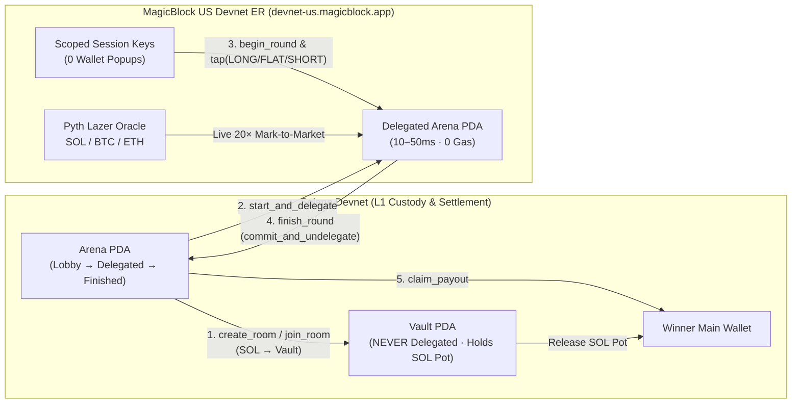

# CandleRoyale

**60-second PvP micro-trading battle royale on Solana & MagicBlock Ephemeral Rollups.**

2–6 players escrow real SOL into a Solana L1 vault, delegate the battleground into a **MagicBlock Ephemeral Rollup**, and race for 60 seconds flipping **20× LONG / FLAT / SHORT** against live **Pyth Lazer** feeds with **zero gas** and **zero wallet popups** via scoped in-browser Session Keys. When the clock hits zero, MagicBlock commits and undelegates the verified winner back to Solana L1 to unlock the entire pot.

Built for **MagicBlock Solana Blitz v10 — Theme: Entertainment Finance**.

---

## Why MagicBlock Is Load-Bearing

A 60-second tap-trading battle is impossible on base Solana L1:

| Requirement | Base Solana L1 | CandleRoyale on MagicBlock |
|---|---|---|
| Rapid position flips (`LONG / FLAT / SHORT`) | ~400ms slots + fee every tap | **Sub-50ms ER execution, 0 gas** |
| Wallet UX during 60s sprint | Phantom popup every click | **Scoped Session Key** bound once at `join_room` |
| Price feed freshness | ~400ms base updates | **Live Pyth Lazer on ER** (~50–200ms ticks) |
| Funds security | Single-layer | **L1 Vault PDA never delegated**; only `Arena` PDA enters ER |

Remove MagicBlock Ephemeral Rollups, Session Keys, or the ER Pyth Lazer feed and the product breaks.

---

## Architecture



---

## On-Chain Endpoints & Program

| Resource | Value |
|---|---|
| **Program ID (Devnet)** | `72pppjfTWKZ9GQARXtt2dkB4t8VNDaL5gA84MajAUXFS` |
| **MagicBlock ER RPC** | `https://devnet-us.magicblock.app` |
| **ER Validator (US Devnet)** | `MUS3hc9TCw4cGC12vHNoYcCGzJG1txjgQLZWVoeNHNd` |
| **Delegation Program** | `DELeGGvXpWV2fqJUhqcF5ZSYMS4JTLjteaAMARRSaeSh` |
| **Pyth Lazer Oracle Program** | `PriCems5tHihc6UDXDjzjeawomAwBduWMGAi8ZUjppd` |
| **SOL/USD ER Feed** | `ENYwebBThHzmzwPLAQvCucUTsjyfBSZdD9ViXksS4jPu` |
| **BTC/USD ER Feed** | `71wtTRDY8Gxgw56bXFt2oc6qeAbTxzStdNiC425Z51sr` |
| **ETH/USD ER Feed** | `5vaYr1hpv8yrSpu8w3K95x22byYxUJCCNCSYJtqVWPvG` |

---

## Verified Live On-Chain Proof (Solana Devnet ↔ MagicBlock ER)

Every step of a real 2-player SOL match — plus 6 live negative security assertions — was executed end-to-end via `npm run e2e:devnet` on Solana Devnet and MagicBlock US Devnet ER (`devnet-us.magicblock.app`):

| Step | Layer | Signer | Proof / Latency |
|---|---|---|---|
| **Program Deploy (Hardened)** | Solana L1 | Authority | [`2HgxE6Tf...H1z3que`](https://explorer.solana.com/tx/2HgxE6Tf7emy8NhXzi91vqnbWvajq9uKYsnqP46Ydv2j5U98fHw5r8UzWLSXpLdBut6PXCFVmPQ6aBiaAH1z3que?cluster=devnet) (`72pppjfTWKZ9GQARXtt2dkB4t8VNDaL5gA84MajAUXFS`, `450 KiB` max len) |
| **`create_room`** (0.01 SOL) | Solana L1 | Player A | [`2365ZbSz...NY71FoX`](https://explorer.solana.com/tx/2365ZbSzhme4zr6io5JKGq7RoHBGMrWepAb4has4rR4fa55Q511Sma9zbd1Sy2mK262BcDHP2XNFGmUCSNY71FoX?cluster=devnet) |
| **`join_room`** (0.01 SOL) | Solana L1 | Player B | [`3pNPDqBt...z3KoSsc8`](https://explorer.solana.com/tx/3pNPDqBtyJ3vUeBHue8wasE5Q5ymrYeWh1JbZyQb9VspcTowRVHRNee4JN9TY7LQSHRab3iHgHkj4kBoz3KoSsc8?cluster=devnet) (pot = 0.02 SOL) |
| **`start_and_delegate`** | Solana L1 → ER | Creator (Player A) | [`4QME4gbx...ZSqeUYJ5`](https://explorer.solana.com/tx/4QME4gbx2iZ9rVVxScyaNTMt1Pg2Xp23vKGHD5YsRsRFFHFhSdwzAJfLT3RQRAj7Hq3ueB3SgUjGxrSJZSqeUYJ5?cluster=devnet) (`owner == DELeGGv...`, pinned validator verified) |
| **`begin_round`** | MagicBlock ER | 0-SOL Session Key A | `69ms` · 0 gas · `5oMh7HvdrsHLTDvTHaizuFbTSRCVQCd4cecZMuDbbgaigxJcnAd77VMrKWU3YRBbhQjsKHfuQHcR3rVgAvvJD357` |
| **5× `tap(LONG/SHORT/FLAT)`** | MagicBlock ER | 0-SOL Session Keys A & B | `66–125ms` HTTP RTT · 0 gas · Live Pyth Lazer SOL/USD (`$70.3596 → $70.3708`, `<= 10s` freshness) |
| **`finish_round`** (`commit_and_undelegate`) | MagicBlock ER → L1 | 0-SOL Session Key A | `130ms` · 0 gas · `2n9HQycdrs89R7qKmS8VpZGABTkaDKvRoPTSaSjDwqUbyPhJewvBLhaudQ9XaGx3M8Lph9Fqh6x4XDLjUhREB1ms` |
| **`claim_payout(seat=1)`** (`+0.02000 SOL`) | Solana L1 | Permissionless → Seat 1 | [`467UsYf8...QviH4b79`](https://explorer.solana.com/tx/467UsYf87YduwJcr5ZNY3pPxZE44u3HirnrmoWrc1mvJCikQyGM8166YhS6dYRRVRSh77YakxB84aaRAQviH4b79?cluster=devnet) (Winner Seat 1, `winnerMask=0b10`) |
| **Live Security Rejections** | L1 + ER | Automated Negative Suite | All 6 rejected on-chain: colliding session key, rogue ER validator, non-creator delegate, premature `abort_stale_room`, `FLAT -> FLAT` no-op tap, duplicate `claim_payout` |
| **Verified Room PDAs** | Solana L1 | — | [Vault PDA (`62iM6M...`)](https://explorer.solana.com/address/62iM6M3XF8nqKhY7aMzbTH6FHBWNG1eN6QEDefzAR76?cluster=devnet) · [Arena PDA (`9KebNx...`)](https://explorer.solana.com/address/9KebNxQ7ProwjQE4z55Jjm2KtzFtWLEeazvzKJ5zPhRQ?cluster=devnet) |

---

## Security Hardening

All game-logic and liveness invariants enforced on-chain (verified by 8 Rust unit tests and 6 live negative assertions in `npm run e2e:devnet`):

1. **No Settlement-Timing Free Option:** `finish_round` only accepts a live oracle close within a `3s` grace window (`now <= ends_at + 3` and `publish_time <= ends_at + 3`). After grace expires, open positions close deterministically at `arena.last_price`, eliminating timing-bot advantages.
2. **Pinned ER Validator + Creator Start Control:** `start_and_delegate` verifies `payer == arena.creator`, resets `arena.created_at` at delegation time, and rejects any `remaining_accounts[0]` other than the hardcoded `PINNED_ER_VALIDATOR` (`MUS3hc9TCw4cGC12vHNoYcCGzJG1txjgQLZWVoeNHNd`).
3. **No Permanently Stuck Lobby or Delegated Funds:** If a joined L1 `Lobby` is never started within `900s` (`L1_LOBBY_TIMEOUT_SECS`), any seated player can call `abort_stale_lobby` on L1 to unlock per-seat refunds via `claim_payout`. If a delegated `Lobby` never starts trading within `180s` (`STALE_LOBBY_TIMEOUT_SECS`), anyone can call `abort_stale_room` on ER to mark `ArenaStatus::Aborted`, `commit_and_undelegate` back to L1, and unlock per-seat entry-fee refunds via `claim_payout`. If a player loses their `sessionStorage` key across tabs, the frontend transparently falls back to direct wallet signing on ER.
4. **Tight Oracle Freshness (`10s`):** `MAX_ORACLE_AGE_SECS` is enforced at `10` seconds (down from 300s) against live ~0–1s Pyth Lazer ticks, preventing stale-feed frontrunning at 20× leverage.
5. **Fair Tie Splitting & No-Op Spam Protection:** `tap` rejects same-direction no-ops (`NoOpPositionChange`), and `finish_round` records a `winner_mask` bitmask across all seats tied at `best_pnl` so `claim_payout` splits the escrowed pot equally across tied winners.
6. **Session Key Isolation:** `create_room` and `join_room` reject `Pubkey::default()` and enforce strict uniqueness across all seated wallets and session keys (`SessionKeyCollision`); `tap` matches `session_key` before `wallet`.

---

## Program Instructions

| Instruction | Layer | Signer | Purpose |
|---|---|---|---|
| `create_room` | Solana L1 | Creator Wallet | Initializes `Vault` (68B) + `Arena` (700B) PDAs, escrows creator's SOL, binds Seat 0 `session_key` |
| `join_room` | Solana L1 | Joiner Wallet | Escrows entry SOL into `Vault` PDA, enforces disjoint `session_key` binding |
| `cancel_room` | Solana L1 | Creator Wallet | Refunds solo creator on L1 if nobody else joined |
| `abort_stale_lobby` | Solana L1 | Any Seated Player | Escape hatch after 900s unstarted joined L1 `Lobby`; marks `Aborted` to unlock per-seat L1 refunds |
| `start_and_delegate` | Solana L1 | Creator Wallet | Verifies creator + hardcoded `PINNED_ER_VALIDATOR`, resets delegation clock, and delegates `Arena` PDA to MagicBlock ER |
| `begin_round` | MagicBlock ER | Session Key / Player | Locks live Pyth Lazer opening price (`<= 10s` age) & starts countdown (0 gas) |
| `tap` | MagicBlock ER | Session Key / Player | Rejects no-ops, marks previous position to market at 20× leverage & flips `LONG / FLAT / SHORT` (0 gas, 0 popups) |
| `finish_round` | MagicBlock ER | Permissionless | Closes open positions (live oracle within 3s grace, deterministic `last_price` after), computes `winner_mask`, calls `commit_and_undelegate` |
| `abort_stale_room` | MagicBlock ER | Permissionless | Escape hatch after 180s idle delegated `Lobby`; marks `Aborted` and calls `commit_and_undelegate` to unlock L1 refunds |
| `claim_payout` | Solana L1 | Permissionless | Per-seat (`seat_index`) L1 Vault payout for single winner, equal multi-way tie split, or `Aborted` entry-fee refund (`claimed_mask` guards against double claims) |

---

## Quickstart

### 1. Build & Test the On-Chain Program
```bash
cargo test --manifest-path programs/candleroyale/Cargo.toml
cargo-build-sbf --manifest-path programs/candleroyale/Cargo.toml --sbf-out-dir target/deploy
```

### 2. Deploy to Solana Devnet & Run Live L1 ↔ ER E2E Verification
```bash
# Ensure deployer wallet has ~3.5 Devnet SOL
solana program deploy target/deploy/candleroyale.so \
  --program-id target/deploy/candleroyale-keypair.json \
  --url https://api.devnet.solana.com

# Verify codec + live Pyth Lazer ER feeds
npm install
npm run test:codec

# Run full 2-player Devnet + MagicBlock ER lifecycle test
npm run e2e:devnet
```

### 3. Run the Web Arena
```bash
cd app
npm install
npm run dev
```
Open `http://localhost:3000`. Use **Phantom** in Window 1 and **Solflare** (or the built-in **Devnet Burner Keypair**) in Window 2 for live 2-tab PvP on Devnet.
